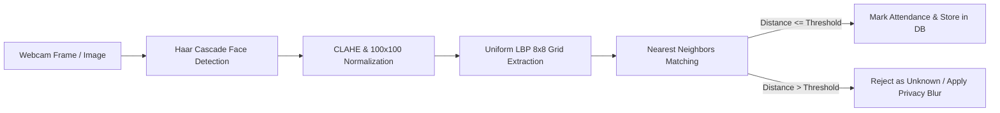

# Smart Classroom Attendance Pro Suite 🎓👁️

> **Production Classical Computer Vision Pipeline & FastAPI Dashboard for Automated Classroom Attendance**

[](https://fastapi.tiangolo.com)
[](https://opencv.org)
[](https://python.org)
[](LICENSE)

---

## 🌟 Key Highlights

- **Classical Vision Engine (No Heavy Deep Learning Required):**
  - **Haar Feature-based Cascade Classifiers** for multi-scale face localization.
  - **CLAHE (Contrast Limited Adaptive Histogram Equalization)** to eliminate uneven illumination shadows.
  - **Uniform Local Binary Patterns (LBP, $R=1, P=8$):** Partitioned into an $8 \times 8$ grid yielding a robust $3{,}776$-dimensional feature descriptor.
  - **Nearest Neighbors Classifier with Adaptive Intra-Class Thresholding:** Graceful rejection of unknown individuals and background faces.
- **Privacy-by-Design & Ethics:**
  - Automatic **privacy blurring** for non-consenting / unknown faces.
  - **DoD 5220.22-M 3-Pass Salted Cryptographic Purge** endpoint for secure biometric data destruction.
- **Full-Stack Interactive Dashboard:**
  - Real-time webcam streaming & frame verification.
  - Admin enrollment studio with live bounding box cropping.
  - Dual SQLite & CSV attendance synchronization.
  - Live analytics, confidence distribution, and exportable audit reports.

---

## 📂 Project Architecture

```
Ai-Project/
├── server.py                   # Production FastAPI server & REST API
├── attendance.db               # SQLite database storing attendance records
├── model.pkl                   # Serialized LBP NearestNeighbors model
├── requirements.txt            # Python dependencies
├── src/
│   ├── model_manager.py        # LBP extraction, CLAHE, nearest neighbors & training
│   ├── database.py             # SQLite CRUD, stats aggregation & CSV synchronization
│   ├── admin_enroll.py         # Face capture & multi-sample enrollment logic
│   ├── live_attendance.py      # Real-time inference & privacy blurring pipeline
│   ├── tune_detector.py        # Grid search optimizer for Haar parameters
│   └── evaluate_robustness.py  # Noise, occlusion & illumination benchmarking
├── static/
│   ├── index.html              # Modern, glassmorphism dashboard UI
│   ├── css/                    # Custom styling & responsive layouts
│   └── js/                     # Client-side webcam handler & API connectors
├── dataset/                    # Normalized 100x100 training face crops
├── logs/                       # Synchronized attendance CSV logs
├── reports/                    # Bias, ethics, and detector tuning markdown reports
└── raw_inputs/                 # Raw high-resolution source captures
```

---

## 🚀 Quickstart Guide

### 1. Clone the Repository
```bash
git clone https://github.com/gandhivr/Ai-Project.git
cd Ai-Project
```

### 2. Install Dependencies
```bash
pip install -r requirements.txt
```

### 3. Launch the Server
```bash
python server.py
```
Open your browser and navigate to:
👉 **[http://localhost:8000](http://localhost:8000)**

---

## 📡 API Endpoints Overview

| Method | Endpoint | Description |
| :--- | :--- | :--- |
| `GET` | `/` | Serves the interactive Attendance & Admin Dashboard |
| `GET` | `/api/status` | Engine status, enrolled students count, rejection threshold |
| `GET` | `/api/attendance` | Recent attendance logs with timestamps & confidence scores |
| `GET` | `/api/students` | List of currently enrolled students and sample counts |
| `POST` | `/api/verify_frame` | Ingests base64 frame, detects faces, predicts identity, logs presence |
| `POST` | `/api/enroll_crop` | Saves face crop for a student and triggers dynamic model retraining |
| `POST` | `/api/purge` | Executes 3-pass cryptographic wipe of biometric data & database |

---

## 🔬 Computer Vision Pipeline Details



1. **Face Detection:** OpenCV Haar Cascade detects frontal faces across variable scales.
2. **Preprocessing:** Grayscale conversion followed by CLAHE (`clipLimit=2.0`, `tileGridSize=(8, 8)`) standardizes lighting.
3. **LBP Feature Vector:** Uniform patterns with 59 bins over 64 sub-blocks form a $59 \times 64 = 3{,}776$ feature vector.
4. **Classification & Verification:** 1-NN Euclidean distance matched against enrolled centroids. If minimum distance exceeds the tuned threshold, the face is rejected as unknown.

---

## 🔒 Ethics, Consent & Data Governance

This project adheres to ethical biometrics principles:
- **Explicit Consent Forms:** Generated and tracked via `generate_consent_forms.py`.
- **Right to Erasure:** Full compliance with biometric data destruction standards via cryptographic overwrite.
- **Fairness & Bias Auditing:** Documented in [reports/ethics_and_bias_report.md](reports/ethics_and_bias_report.md).

---

## 👨‍💻 Author

**Vraj Gandhi**  
GitHub: [@gandhivr](https://github.com/gandhivr)
